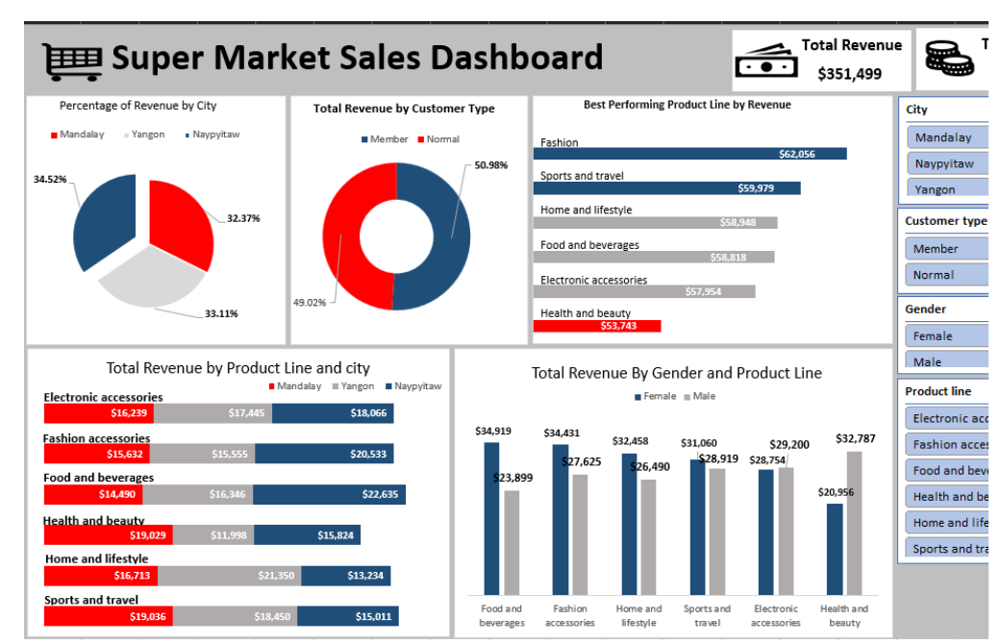

# Supermarket Sales Dashboard | Excel

An interactive Excel dashboard built to analyse supermarket sales performance, customer purchasing patterns, and product line revenue.

## Project Overview

This project uses supermarket sales data to explore business performance across different cities, product lines, customer types, and payment methods. The dashboard presents key metrics and trends in a visual format to make the data easier to understand and use for decision-making.

## Business Problem

Supermarkets generate sales data across multiple products, locations, and customer groups. Without a clear summary, it can be difficult to identify which product lines perform best, which locations generate the most revenue, and how different customer groups contribute to sales.

This project addresses that challenge by organising the data into an interactive dashboard that makes important sales patterns easier to identify.

## Project Objectives

* Analyse overall sales and revenue performance.
* Compare performance across cities and product lines.
* Examine purchasing patterns by customer type and gender.
* Explore payment methods and customer purchasing behaviour.
* Present key findings in a dashboard that supports data-driven decisions.

## Tools Used

* **Microsoft Excel**
* PivotTables and PivotCharts
* Data cleaning and preparation
* Excel formulas and aggregations
* Interactive dashboard design
* Data visualisation

## Dashboard Preview

## Key Performance Indicators

The dashboard highlights key business metrics, including:

* **Total Revenue:** Overall revenue generated from sales.
* **Total Sales:** Total sales value recorded in the dataset.
* **Total Tax:** Tax collected across transactions.
* **Revenue by City:** Comparison of revenue generated across supermarket locations.
* **Revenue by Product Line:** Identification of product categories contributing to revenue.
* **Customer Type:** Comparison of revenue from member and normal customers.

## Key Insights

The analysis highlights differences in sales performance across locations, product categories, and customer groups.

* **City performance:** Naypyitaw recorded the highest revenue among the cities analysed.
* **Product performance:** Fashion accessories generated the highest revenue among the product lines.
* **Customer type:** Member customers contributed approximately 50.98% of revenue, while normal customers contributed 49.02%.
* **Sales performance:** The dashboard provides a consolidated view of revenue, sales, and tax to support comparisons across the business.

These findings help demonstrate how spreadsheet analysis can turn transaction data into useful business information.

## Interactive Features

* Filter sales data to explore different business categories.
* Compare performance across cities and product lines.
* Examine customer segments and payment methods.
* View key performance indicators alongside charts for easier interpretation.

*Note: Available filters and interactive features depend on the functionality implemented in the Excel workbook.*

## Skills Demonstrated

* Data cleaning and preparation
* Exploratory data analysis
* PivotTables and PivotCharts
* KPI reporting
* Dashboard development
* Data visualisation
* Business insight generation
* Communicating findings for decision-making

## Project Files

* `Supermarket_Sales_Dashboard.xlsx` — Excel workbook containing the dashboard and analysis.
* `dashboard-preview.png` — Dashboard preview displayed in this README.

## Conclusion

This project demonstrates how Microsoft Excel can be used to analyse supermarket transactions, monitor business performance, and communicate findings through an interactive dashboard.

It also strengthened my ability to work with structured datasets, identify sales patterns, and present information in a format that supports business decision-making.

## Author

**Orherime Betty Ejakpovi** — Data Analyst | Excel · SQL · Power BI

[LinkedIn](https://www.linkedin.com/in/orherime-ejakpovi) · [Portfolio](https://betsej.github.io/)

